# E-MAN Mitra Portal
## Visual User Guide — From Login to Field Operations

Version 1.0 · Screenshots captured 12 October 2026 · Responsive portal view (680 × 980)

**Portal URL:** http://localhost:4000/mitra/login  
**Demo account:** `mitra10@demo.eman.test`  
**Demo password:** `1234`

This guide follows the Mitra portal's normal field workflow. It covers login, the dashboard, Naka survey submissions, client onboarding, worker onboarding, conflicts, and leave requests. The portal is designed for mobile use; screenshots show the responsive layout. The portal is scoped to the signed-in Mitra's assigned records.

Screenshots show demo/test data. The add-client and add-worker wizard screenshots include temporary browser-only sample entries to demonstrate form states; those forms were not submitted. No Naka, client, worker, conflict, or leave records were created or changed for this guide.

## Navigation and Access

The top bar has the E-MAN brand and a three-dot menu. The menu links to **My Nakas**, **Leaves**, and **Logout**. The bottom navigation links to **Home**, **Workers**, **Add**, **Clients**, and **Conflicts**. Select **Add** to open a quick-action sheet with Add Worker, Add Client, and Submit Naka.

A Mitra can manage only that Mitra's own clients, assigned workers, assigned Nakas, conflicts and leave requests. Naka submissions are sent to Admin for verification; Mitras cannot mark a Naka Verified.

## Part 1 — Sign In and Review Work

### 1. Mitra Login

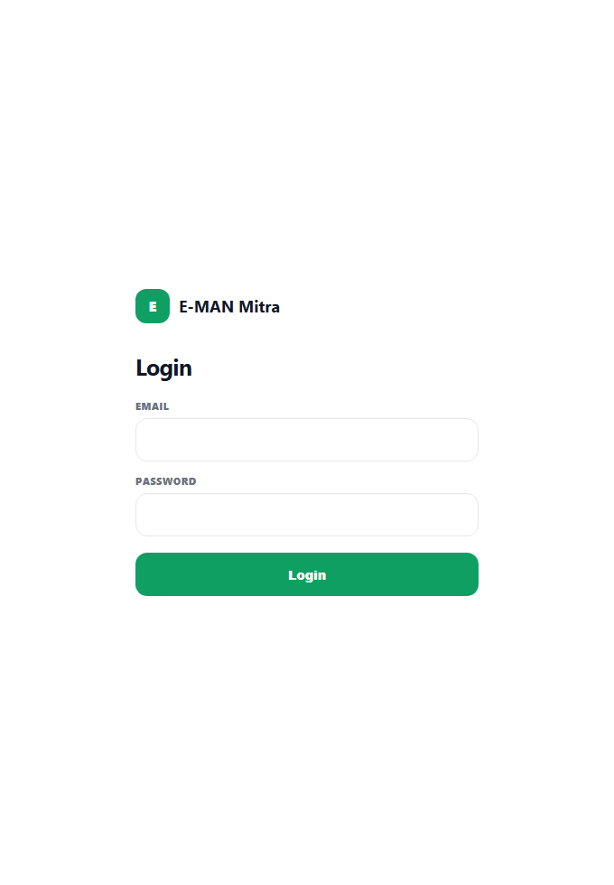

Open `/mitra/login`, enter the assigned Mitra email and password, and select **Login**. Successful authentication opens the Mitra Dashboard. A Mitra session is held in the browser; choose **Logout** from the top-right menu when finished.

Demo access shown for this guide is `mitra10@demo.eman.test` with password `1234`. These are demo-only credentials from the project's demo seed. Use the organization's assigned credentials for normal operation.

### 2. Dashboard and Quick Actions

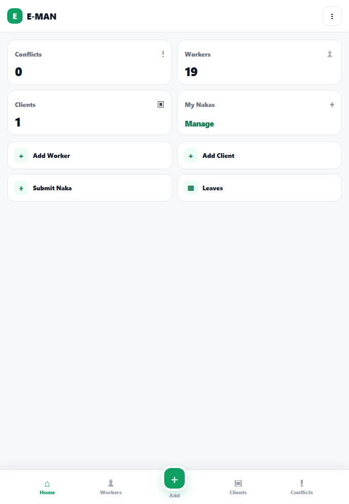

The Dashboard is the starting point for field work. Cards link to Pending Worker Conflicts, Workers, Clients, and My Nakas. Quick actions below the cards open **Add Worker**, **Add Client**, **Submit Naka**, and **Leaves**. The conflict attention link appears when worker requests are pending.

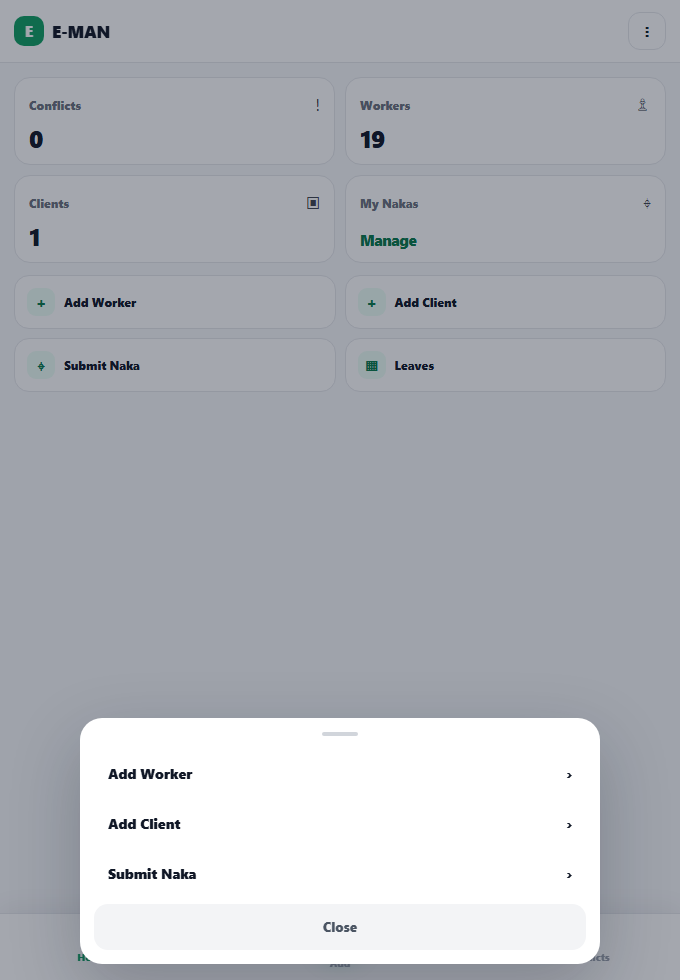

The center **Add** button in the bottom navigation opens this sheet. Close it with **Close**, tap outside it, or choose one of the listed actions.

## Part 2 — Manage Nakas in Your Assigned Area

### 3. My Nakas

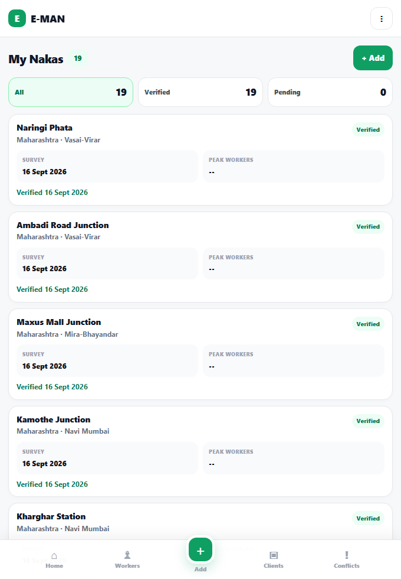

The page shows Nakas assigned to the signed-in Mitra. Use **All**, **Verified**, or **Pending** to filter. Each card includes its State/City, status, survey date, peak worker count, and last verification date when verified. Choose **+ Add** to submit a newly surveyed Naka.

Only Verified Nakas are currently operational. Verification that is more than six months old appears as requiring re-verification. A Mitra-submitted Naka remains pending until an Admin reviews and verifies it.

### 4. Submit Naka

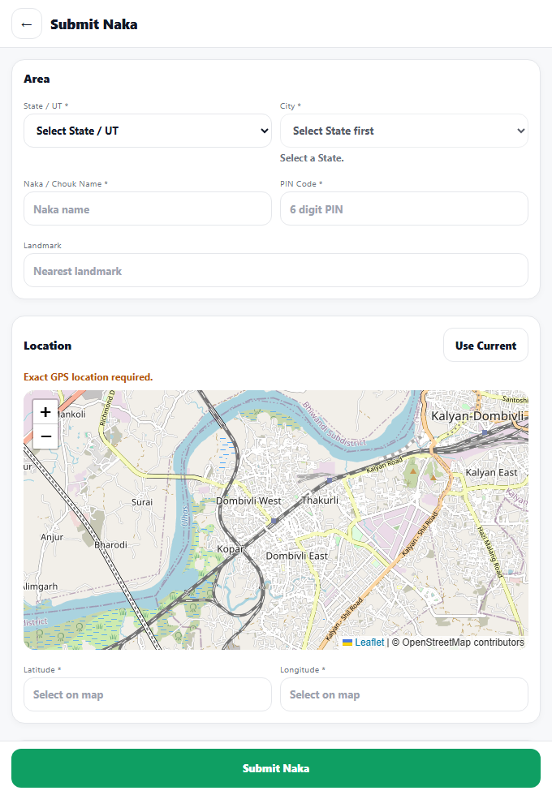

Complete the form in order:

1. **Area:** choose State/UT, then a City in that State; enter Naka name, six-digit PIN code, and an optional landmark.
2. **Location:** select the exact map point by clicking/dragging the marker or choose **Use Current**. Latitude and longitude are required.
3. **Survey:** select confidence, survey date, and a whole-number peak worker estimate. Upload a verification photo; add optional notes.
4. Select **Submit Naka**. The submission is recorded as **Pending Verification** and linked to your account. Admin must verify it before it becomes operational.

Do not submit a guessed GPS point. Allow location permission while physically at the labour gathering point, or select the exact point on the map. State/City must match, the PIN must be six digits, and the verification photo is required.

## Part 3 — Onboard and Maintain Clients

### 5. Clients List

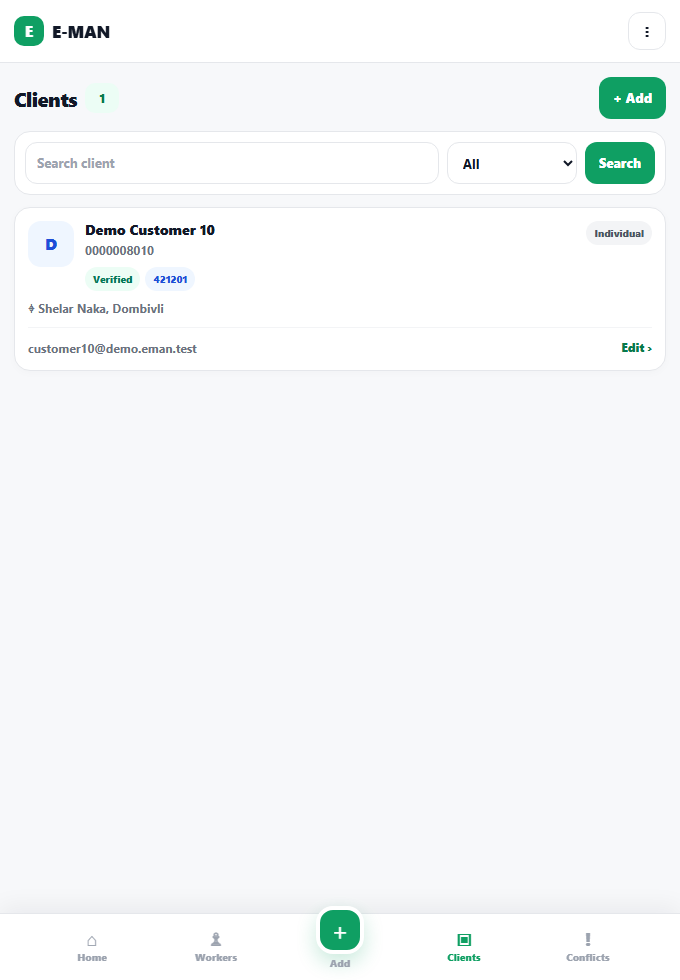

The list shows clients assigned to you. Search by contact name, business name, phone, or email. Filter to **All**, **Individual**, or **Company**. Cards show verification state, approximate worker requirement, saved PIN/site information, and **Edit**. Choose **+ Add** to start a new client record.

### 6. Add Client — Step 1: Basic Profile

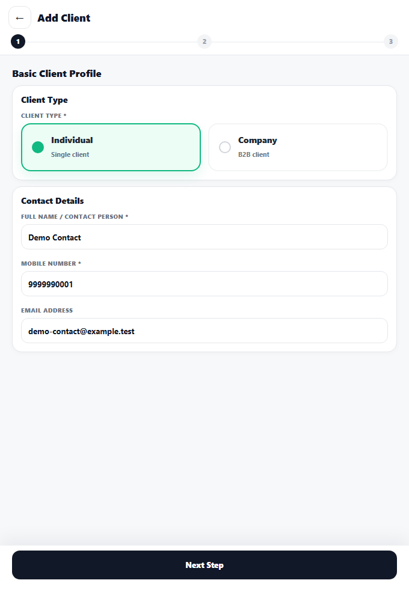

Choose **Individual** or **Company**, enter the contact person's name and a valid 10-digit Indian mobile number, and add an email if available. Company-only details appear on the next step. Select **Next Step** to continue; use **Back** to return to a prior step.

### 7. Add Client — Step 2: Work Site and Business Details

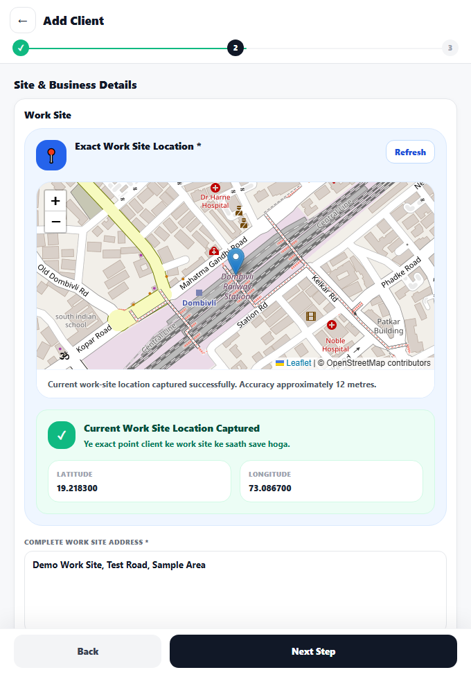

The browser requests current location when this step opens. Allow location permission while at the actual work site. Confirm the map marker and coordinates; **Refresh** captures a new location and should only be used while at that site. Enter a complete work-site address (room/flat/shop, building, road, area or landmark) and choose the approximate daily worker requirement: 1–5, 5–15, 15–50, or 50+. If **Company** was selected, add company name and industry; GST is optional.

The current location capture and written site address are both required. The written address must be at least 10 characters. The location is saved as the client's Primary Work Site.

### 8. Add Client — Step 3: Verify Mobile

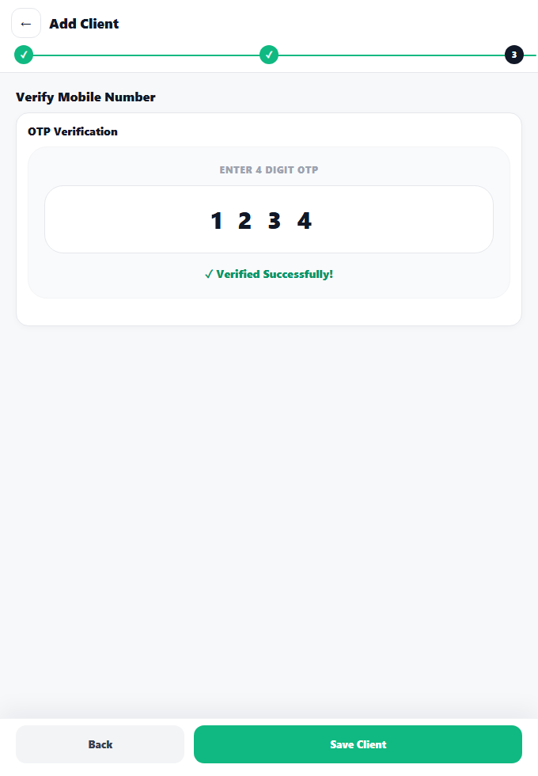

Enter the four-digit OTP sent to the client's mobile and select **Verify OTP**. When the demo OTP feature is enabled, the test code is **1234**. After successful verification, **Save Client** becomes available. Saving assigns the client to the logged-in Mitra and returns to the Dashboard with a success message.

### 9. Edit Client — Review and Update

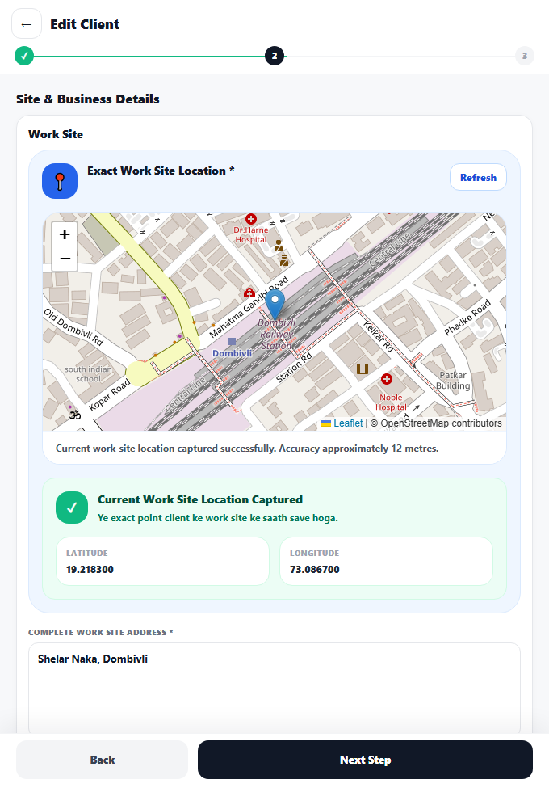

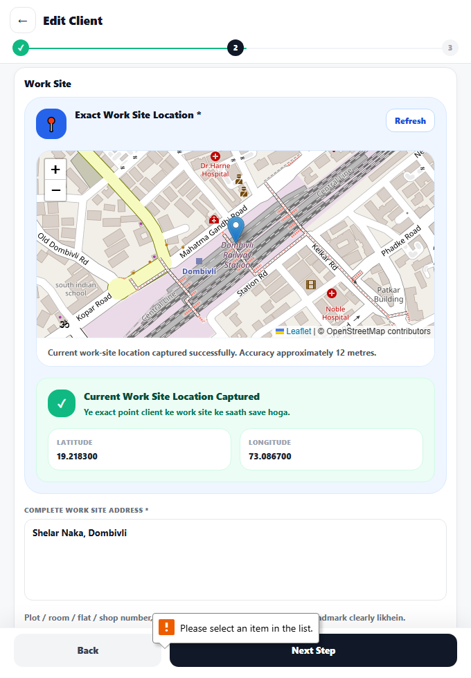

Select **Edit** on a client card. The add-client wizard is reused with existing values filled in. Review the client profile, site/address, worker requirement, and (for companies) business details. OTP is skipped in edit mode. Select **Update Client** on the final review step.

Change the saved current location only when you are at the actual work site. A phone or email already used by another client is rejected; the same client's existing phone/email can remain unchanged.

## Part 4 — Onboard and Maintain Workers

### 10. Workers List

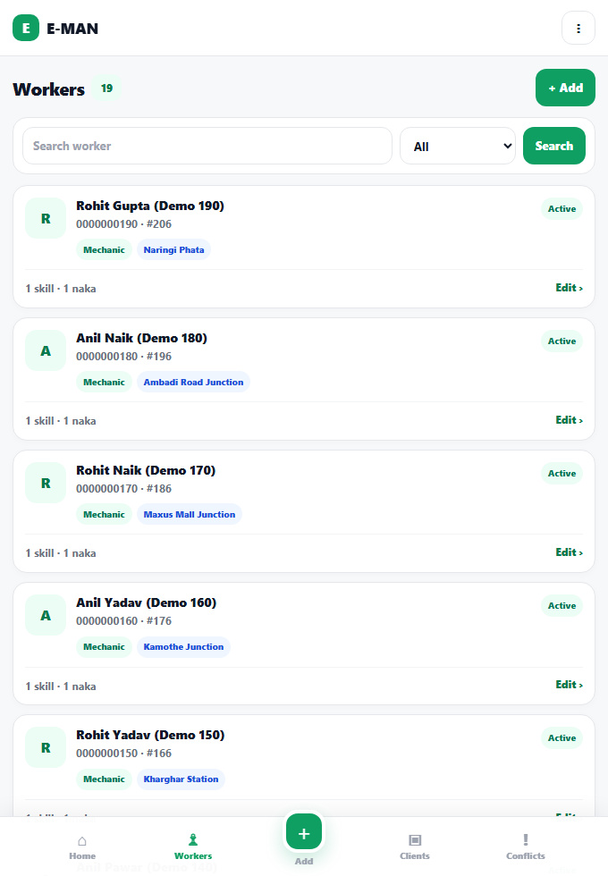

The list contains workers assigned to you. Search by worker name, phone, email, or ID number. Filter to **All**, **Active**, or **Inactive**. Each card shows worker contact, active state, skills, and assigned Nakas. Select **+ Add** or **Edit**. Worker records outside your Mitra assignment cannot be opened or updated here.

### 11. Add Worker — Step 1: Basic Details

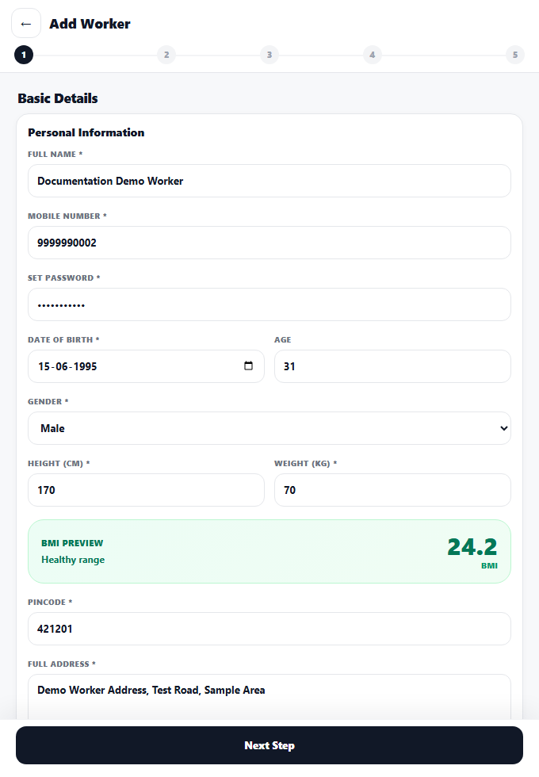

Enter the worker's name, 10-digit mobile login, a password of at least six characters, date of birth, gender, height and weight. Age and BMI preview are calculated. Worker age must be 18–100 years; height and weight must be within the displayed valid ranges. Enter a six-digit PIN code and a complete address of at least 10 characters, then select **Next Step**.

The screenshot's sample values are illustrative and were not saved.

### 12. Add Worker — Step 2: Identity Verification

Select an identity proof type (Aadhaar, PAN, Voter ID, or Driving License) and enter its number. The format depends on the selected type: Aadhaar is 12 digits, PAN follows the displayed letter/digit pattern, and Voter ID/Driving License requires an acceptable ID string. Existing duplicate IDs are rejected. Select **Next Step** after checking the details.

### 13. Add Worker — Step 3: Skills and Assigned Nakas

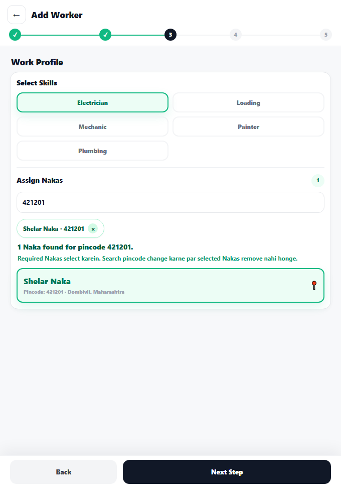

Select at least one skill. Search Nakas using a six-digit PIN code; results include only Nakas assigned to your Mitra account and currently verified. Select at least one result. The selected Naka chips remain selected if you search another PIN. Continue with **Next Step** after both a skill and a Naka are selected.

### 14. Add Worker — Step 4: Payment Details

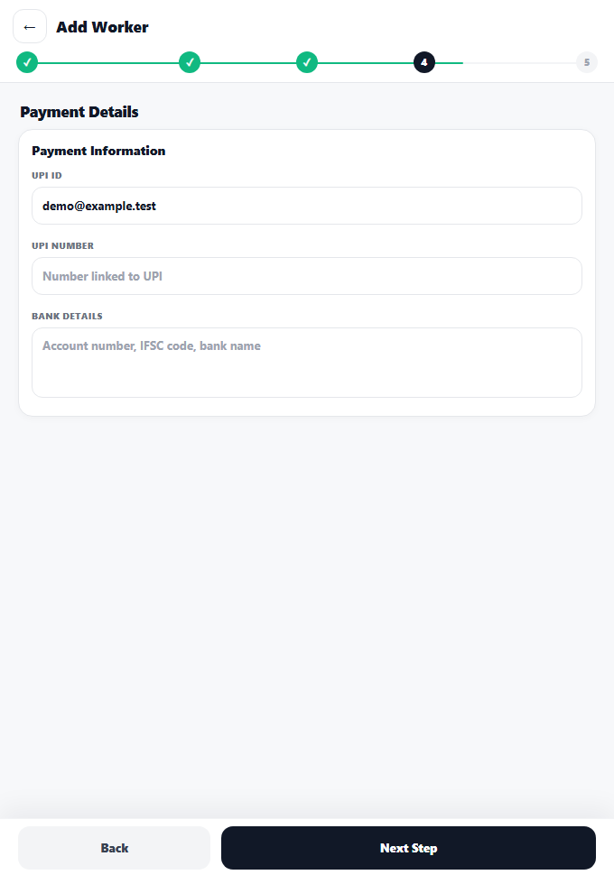

Enter at least one of **UPI ID**, **UPI Number**, or **Bank Details**. The other fields are optional. Select **Next Step** after adding one payment method.

### 15. Add Worker — Step 5: Video Consent and Complete KYC

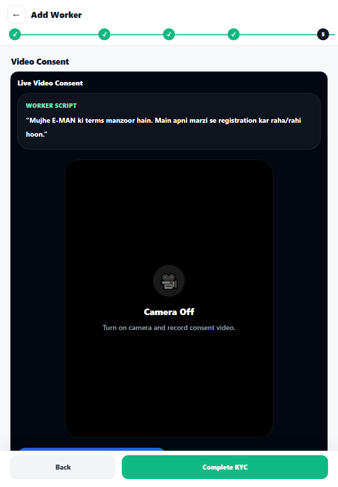

Read the displayed consent statement with the worker. Enable the camera, record the consent, review/retake if necessary, or use the available video upload control. Select **Complete KYC** only when the required profile information and consent video are ready. The screenshot shows the camera-off state; camera permission and a recording are required to complete a new worker's KYC.

### 16. Edit Worker — Review the Same Five Sections

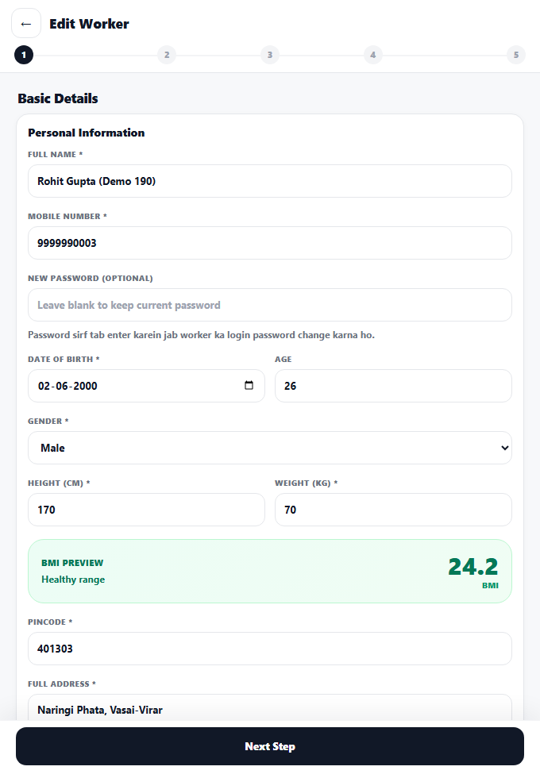

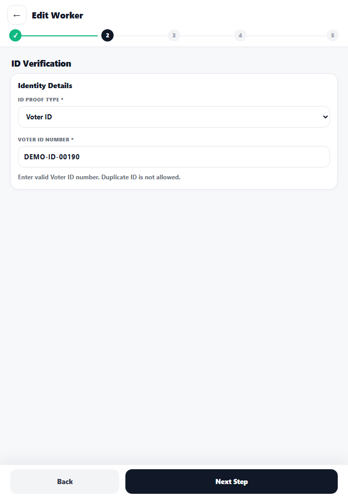

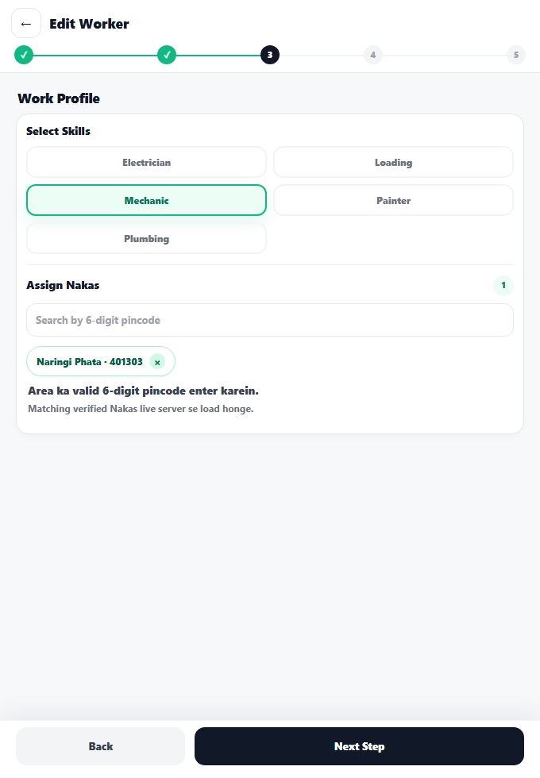

Open **Edit** from your Workers list. The same five-step flow is populated with the worker's current details. On Step 1, leave **New Password** blank to keep the current password. Review the identity proof, skills/Nakas, payout details, and consent video. If a consent recording already exists, keep it or record a replacement as needed. Finish with **Update Worker**. The captured edit screen has a temporary valid mobile value in the browser to demonstrate forward navigation; the form was not saved.

## Part 5 — Survey Areas, Resolve Conflicts, and Request Leave

### 17. My Nakas

Use **All**, **Verified**, and **Pending** to track Nakas assigned to you. Verified status and last verification date show whether the location is available for operational matching. Select **+ Add** to submit a newly surveyed location; the Admin reviews the submission.

### 18. Submit Naka

Fill State/UT, City, Naka/Chouk name, six-digit PIN, and optional landmark. Select the exact point on the map or **Use Current**; latitude and longitude are required. Complete confidence, survey date, peak worker estimate, verification photo, and optional notes. Select **Submit Naka** to send it for Admin verification.

The Mitra portal records the new Naka as pending and assigns it to the submitting Mitra. It is not immediately operational. Duplicate Naka names in the same City are rejected. Survey date cannot be in the future, headcount must be a whole number, and the photo is mandatory.

### 19. Conflicts List

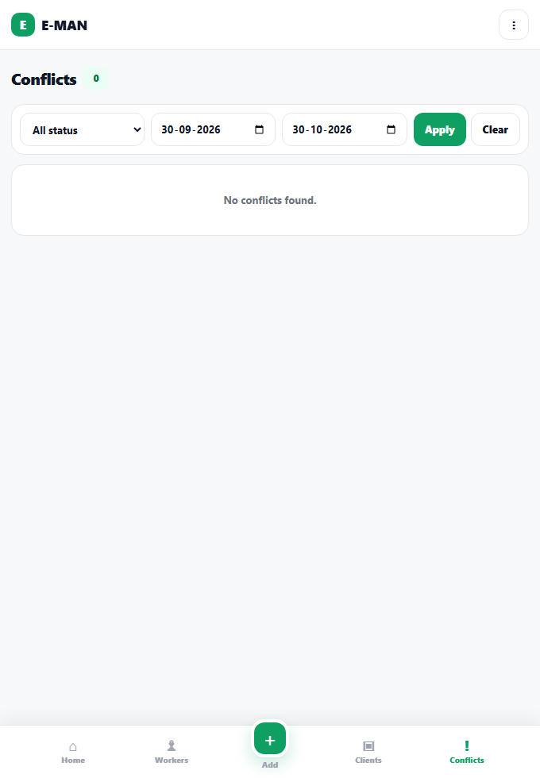

The conflict list contains cases assigned to you. Filter by status and From/To dates. Open a card using **Review** to inspect its booking, client, worker, financial summary, timeline, and decision controls. Clear filters to return to the full assigned list.

### 20. Conflict Review and Decision

No conflict was assigned to the demo Mitra at screenshot time, so there was no detail record available to open. In normal use, open a case from **Conflicts**.

On review, read the reason, description, client/worker details, booking and per-worker amounts, suggested refund, penalty, and previous timeline entries. Select **Pending**, **In Progress**, **Solved**, or **Unresolved**, enter a required Mitra Note, and select **Save Update**. For a worker-raised `CANCEL_DUTY` case marked Solved, enter a whole-number worker penalty; the final penalty is recorded with the decision. Each update is appended to the timeline.

### 21. Leaves

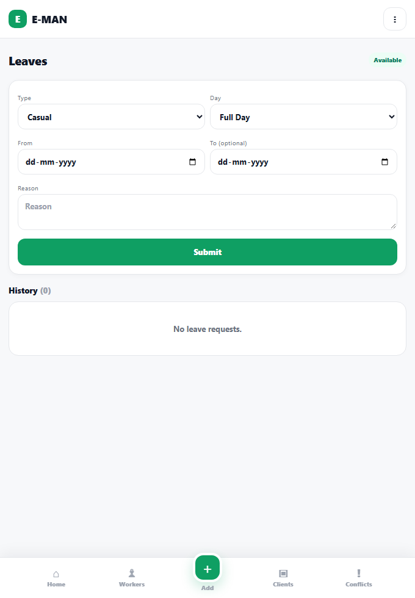

The page shows whether you are currently available or on leave, an application form, and request history. Select leave type, Full/Half Day, From date, optional To date, and enter a reason. Choose **Submit** to send a request to Admin for approval. The history shows request state, dates, reason, and any Admin decision note. Pending or upcoming requests may offer **Cancel**. Active leave can only be ended by Admin.

## Recommended Mitra Work Sequence

1. Sign in and review Dashboard cards and attention items.
2. Check **My Nakas**. Submit a Naka survey if an area is missing; wait for Admin verification before expecting it to be operational.
3. Add or update clients. Capture the actual work-site location and complete the three-step profile/OTP flow for new clients.
4. Add or update workers. Complete identity, skill/Naka, payment and video-consent steps before completing KYC.
5. Use Clients and Workers lists to search and maintain only your assigned records.
6. Review assigned Conflicts and document each decision with a note.
7. Submit leave requests in Leaves and wait for the Admin decision.
8. Use the top menu to log out when field work is complete.

## Screenshot and PDF Maintenance

Screenshots are in `docs/mitra-portal-screenshots/`. They were captured from the running portal at a responsive tablet-width viewport. Temporary sample values were entered only in the browser to demonstrate wizard states; forms were not submitted. To refresh screenshots, set `MITRA_EMAIL`, `MITRA_PASSWORD`, and optionally `MITRA_BASE_URL`, then run:

`node scripts/captureMitraDocumentationScreenshots.js`

To rebuild the illustrated PDF:

`node scripts/generateAdminUserDocumentationPdf.js docs/mitra-portal-user-documentation.md docs/mitra-portal-user-documentation.pdf`
